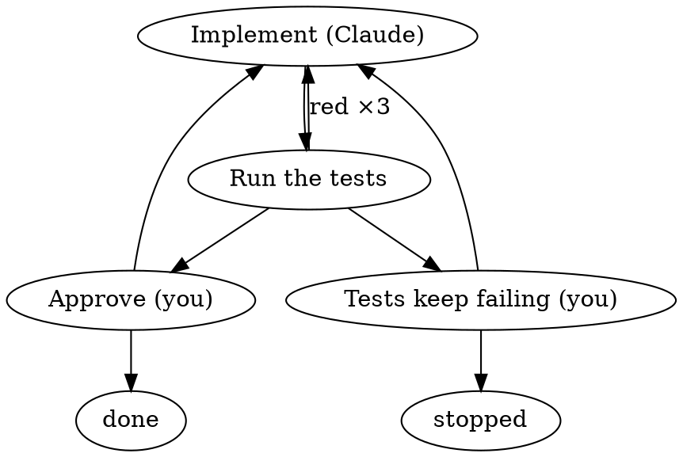

# C11 — The reference coding loop, written out

Design record of the prototype session held on 2026-10-11 for the map ticket **C11 — The reference coding loop, written out** (Web-tree/runspore#16, map #5). It writes the reference workflow in the format C02 settled, with the kinds of C07 and the decisions of C12–C16, and states step by step what you find when you come back after your Claude session, or the whole machine, dies at any point of it. This is the artifact the spec is checked against.

The workflow is the folder [c11-reference-loop/coding-loop/](c11-reference-loop/coding-loop/): `workflow.dot`, `settings.json` and three step files. A clickable prototype drives the same files through every kill case. It draws the DOT live with Graphviz in the browser, highlights the current node and the arrow just taken in both the diagram and the text, and shows what the database holds, what a new session's menu offers, and what is done again. It is on the throwaway branch [`prototype/c11-reference-loop`](https://github.com/Web-tree/runspore/blob/prototype/c11-reference-loop/prototype/c11-reference-loop/index.html) (open the file in a browser; the diagram needs network access to load Graphviz).

Writing the loop out found eight gaps. Every fix is a general capability or a plugin default, never something special to this workflow. Max's rule for the session: "we should not develop the CONCRETE workflow, but create tooling for building workflows flexible."

## Terms

- **Reference loop** — The workflow in [coding-loop/](c11-reference-loop/coding-loop/): Claude implements, `npm test` runs, a red result goes back to Claude at most 3 times in a row before a person is asked, and a person approves. *Avoid:* demo workflow, example (it is the spec's check, not a sample).
- **Arrived from** — The result whose arrow brought the run to the node now being entered: that node's ID, the arrow's outcome and the result's output. A mapping reads it with `{"$get": ["from"]}`; at the start node it is `null`. *Avoid:* previous step (the previous visit of the same node), parent.
- **Coming back** — What a person does after their Claude session died: start a new Claude session, or resume the old one with `claude --resume`. Both find the same run state, because the run lives in spore's database, not in the session. *Avoid:* recovery, reattach.

## Why

The map's destination is proven on one reference workflow that "must survive killing the session mid-step and resuming in a new one". The ticket asked for its DOT file and node files, and then for each step: the run's status after a kill, what the menu offers, and what work repeats.

Max's words during the session:

- On how a step learns why the run came back: "let's think how we would do it in temporal or n8n? we would collect the needed data to pass to the step, if we handle some error, right? why do we try to reinvent the wheel? we should not develop the CONCREETE workflow, but create tooling for building workflows flexible."
- On what a kill is: "if we talk about claude code session we can have only 2 situations: start from scratch or resume existsing."
- On the prototype: "it's strange, that we have the prototype, try to show SOME example of concreete workflow, but don't show the DOT code of that workflow", then "maybe we can even create a visualization of the workflow, not only code?" and "I think it's possible to visualize it in browser?" The final prototype shows the files and draws the DOT in the browser.
- On the result: "yes, it looks good. from the prototype, we can borrow the things with displaying of the workflow state with visuals and highlight text, and integrate something like this in our pluging for claude code as mod." Graduated into a new map ticket (§Changes outside C11).

## The workflow

```text
.spore/workflows/coding-loop/
├── workflow.dot        the graph: nodes, kinds, arrows
├── settings.json       actions, schemas, loop limit, node parameters, inputSchema
└── steps/
    ├── implement.md    for Claude: the task, what `cameFrom` means, how to answer
    ├── approve.md      for the person: what to check, how to answer
    └── tests_stuck.md  for the person: keep going or stop
```



What each step is, in the profile's words (C07) and in Runspore's:

| Node | Profile kind | Runspore | Settings that matter after a kill |
|---|---|---|---|
| `implement` | `agent`, background | `command` running `claude-spore run`, `output: "result"` | `idempotent`, 3 tries, 1 h; one conversation per run and node (C13); input `task` and `cameFrom` (L1); schema `{summary}` |
| `test` | `cmd` | `command` running `npm test`, exit 1 → `red` | `idempotent`, 3 tries (R2), 30 min; `loopLimits: {"red": 3}` |
| `tests_stuck` | `human`, a decision | `await-signal` `tests-stuck` | `keep-going` / `stop`; reached by the `exhausted` arrow |
| `approve` | `human`, a decision | `await-signal` `approval` | `rejected` needs `{reason}` (C12) |
| `done`, `stopped` | — | `complete`, `fail` | `done` returns the task and the last summary |

The interactive form of `implement` changes only its action (C07 R6, C14):

```json
"implement": {
  "kind": "command", "argv": ["claude-spore", "start"],
  "effect": "idempotent", "outcomes": ["ok"], "retry": { "maxAttempts": 3 },
  "async": {
    "timeoutMs": "14400000",
    "probe": { "command": { "argv": ["claude-spore", "probe"] } },
    "watch": { "command": { "argv": ["claude-spore", "watch"] } },
    "stop":  { "command": { "argv": ["claude-spore", "stop"] } }
  }
}
```

## Coming back after a kill, step by step

"Your session dies" means your own Claude session ends any way at all: you close it, it crashes, or it is killed. Its background `spore continue --wait` (C06 L3) dies with it, and so does any step command running under it (C15 stops it: SIGTERM, 5 s, SIGKILL). An interactive step's herdr pane is not part of your session and keeps going. "The machine goes down" stops everything, panes included. Either way you come back in one of two ways: start a new Claude session, or resume the old one. Both show the same session-start line and menu (R9), and the run is where the database says, so you choose Continue (or Decide, or Retry) to follow it again.

| Where the run was | What the database holds | Start line and menu | After Continue: what is done again | What is not |
|---|---|---|---|---|
| Starting from the menu, before `spore start` returned | No run, or a run at `implement` with nothing started | No line, or `working`: Continue, Cancel | Nothing; with no run, start again (Claude's input draft is lost) | — |
| `implement` (background), try *n* | `running`; try *n* cut off. Your session dying records it as stopped at once; the machine going down leaves a lease that runs out in 10 s | `coding-loop at implement (working)`: Continue, Cancel | Try *n*+1 resumes the same conversation ("you were cut off, finish the step"): only the Claude turn in flight, and maybe its last tool call | Edits on disk; earlier visits; test runs; decisions; the red count; visit counts |
| `implement`, try 3 cut off | `needs-intervention`: the step is stuck (C07 L3), error `activity.attempts-exhausted` | `stuck`: Retry, Mark done, Fail, Cancel | Retry: try 4 resumes the same conversation | As above |
| Between steps (a result recorded, the next step not started) | `running`, next step queued | `working`: Continue, Cancel | Nothing; Continue starts the next step | Everything |
| `implement` finished but its answer not yet recorded | `running`; the try is cut off | `working` | Try *n*+1 resumes; Claude sees it already finished and answers again | The edits |
| `test`, try *n* | `running`; try *n* cut off | `coding-loop at test (working)`: Continue, Cancel | `npm test` runs again from the start | `implement`'s recorded result; the red count (a lost try is not a red) |
| `test`, try 3 cut off | stuck | Retry, Mark done, Fail | Retry runs the tests again | — |
| Waiting at `approve` or `tests_stuck` | `waiting` | `decision`: Decide (instructions and the last summary), Cancel | Nothing | Everything |
| A decision sent, not yet acted on | `waiting` with the signal stored | `working` (R5): Continue. Deciding again is a no-op (R4) | Nothing; Continue acts on the stored decision | The decision |
| Stuck step | `needs-intervention` | Retry, Mark done, Fail, Cancel | — | — |
| `implement` (interactive), your session dies | `running`, try held by the pane, which keeps working | `held`: Open its pane, Continue (R3), Abandon, Cancel | Nothing. Continue runs the watch again; if Claude already handed in its answer, the watch returns it at once | Everything |
| `implement` (interactive), the machine goes down | `running`, try held by a pane that no longer exists | `held`, pane gone | The probe answers `dead` at once (R6); try *n*+1 opens a new pane and resumes the same conversation | Edits on disk |
| Completed, failed or cancelled | Ended | No line | — | — |

The red count and the visit counts live in the run's state, so a kill never changes them (C13). If only your Claude process is SIGKILLed while its `continue --wait` survives (C05), that orphan keeps driving the run until it needs a person; a second driver started meanwhile is safe (C06 L1).

## Locked decisions

### L1. A step can read the result that brought the run to it (Max: "how would we do it in temporal or n8n?")

**Decision.** Kernel 0.2 adds `from` to the mapping context: `{"node", "outcome", "output"}` of the result whose arrow the run took into the node being entered, or `null` when the node is entered as the start node. `outcome` is the arrow's name, so an `exhausted` or `failed` arrow shows as such (for `exhausted` the output is the limited step's real output, C13 R4). It is evaluated when the node is entered, like every input mapping, so the run state gains no field. The reference loop maps it into `implement`'s input as `cameFrom`. Claude then gets exactly the failing test output, the reviewer's reason, or the person's hint, and `null` on the first visit.

This is how n8n passes data: a node's input is the output that arrived along its incoming connection. It is also Step Functions' state input, and the argument a Temporal workflow passes to the next activity after it catches an error. In 0.1 a mapping can only name a node (`$get ["nodes", "test", …]`). That path does not exist on `implement`'s first visit, so the run fails as `mapping.missing-path`. Named results also go stale: after a rejection and a red test, both `nodes.approve` and `nodes.test` are there, and nothing says which one sent the run back.

**Rejected.** *Hand the step every node's latest result (`$get ["nodes"]`).* It needs no kernel change, but the step has to guess which result is new, and the workflow author must explain that in prose.

### L2. A command's text output keeps the end of stdout and stderr (Max's rule: tooling, not this workflow)

**Decision.** Host 0.2 `command` with `output: "text"` gives `{"exitCode", "stdout", "stderr", "truncated"}`. When the output does not fit the 64 KiB result limit, each stream keeps its end, cut at a UTF-8 boundary: stderr at most 16 KiB, stdout the rest. `truncated` is `true` when anything was cut. Text mode never fails with `command.output-too-large`; `json` and `result` modes keep that failure, since cut JSON is not JSON. A test run that prints a lot, or prints its compiler errors on stderr, thus reaches the next step as the end of its log, which is where test runners and compilers put the failures. GitHub Actions and GitLab CI keep long logs the same way, by cutting them, not by failing the job.

**Rejected.** *A script bundled with the reference loop that runs the tests and keeps the end of the log.* It works today, but it fixes one workflow and leaves every other command to fail on a long log.

## Routine choices

Settled from standard practice, shown in the prototype as **(C11)** and left standing by Max.

- **R1. Steps run from the project root, recorded on the run.** When `spore` found its database through `.spore/` (C08 R4), host 0.2's `base_dir` is the folder that holds `.spore/`. Otherwise it is the current directory, as in 0.1. `start` records it on the run (store 0.2), and every later dispatch of that run uses the recorded folder. A `continue` typed in a subfolder therefore runs `npm test` where the first try ran it. The same goes for a later driver started anywhere. This is C08 L3's rule that a run belongs to where it was started, applied to the working directory. CI runners do the same with their workspace.
- **R2. Commands that are safe to repeat get 3 tries.** The authoring interview (C09) writes `"retry": {"maxAttempts": 3}` on every `read-only` or `idempotent` command, as C07 R13 does for Claude steps. With 0.1's default of one try, one kill during the tests makes the step stuck and asks a person. A failure the command reports itself (an exit code not in `exitOutcomes`) is retried too, which absorbs a flaky start. Spore's own default stays one try.
- **R3. A held step offers Continue in the menu.** C08's `held` row gains Continue, which follows the run (C06 L3). An interactive step reports only through its watch, and only a driver runs the watch. Without the row, after your session dies nobody picks up Claude's answer until someone types `spore continue`.
- **R4. A decision from the menu carries the step's own ID.** Decide sends `spore signal … --id <activationId>`, for example `approve/2`. Deciding again after a kill repeats the same ID, which spore already treats as a no-op. Without it, a second "rejected" waits in the run's signal buffer and silently rejects the next visit of `approve`. A person at a terminal can pass `--id` the same way.
- **R5. A stored decision makes the run `working`.** In `spore list`, a run that waits at a node for which a matching signal is already stored shows `needs: working`, not `signal`. Continue acts on it, and the menu does not ask for the decision again.
- **R6. The interactive step's holder handle names the process and the boot (closes C07 Q20).** `claude-spore start` records `{"herdrAgent", "session", "pid", "started", "boot", "machine"}`. The pane's launcher writes its own PID and start time before it runs `claude` in its place, so the PID is Claude's. The probe answers `dead` when the boot ID differs from the machine's current one, or when no process has that PID and start time; `alive` when it has; `unknown` from another machine. The herdr name serves only "Open its pane", since herdr clears a name on manual release too (C05). This is C15's process record, kept by the action instead of by spore. After a machine goes down, the step resumes at the next Continue instead of waiting out its 4 h deadline.
- **R7. A Claude step's `tools` are approved, not only offered.** `claude-spore run` passes the `tools` parameter as both `--tools` and `--allowedTools`, with `--permission-mode default` (C04), so a background `implement` with the edits set (C10 R9) can edit and run commands, and nothing else is approved. The edits set approves every Bash command; narrowing that is the map's fog item on permissions and sandboxing.
- **R8. The safety net stays at 16.** One round of the loop takes up to four visits of `implement` and `test`, so the fourth round of "keep going" ends the run as `failed` (`limit.visits-exceeded`, C13 risk). The reference loop keeps the default and says so in `tests_stuck.md`; C09's interview raises `maxVisitsPerNode` only when a person asks for longer rounds.
- **R9. Coming back is the same either way (Max: "only 2 situations").** A new Claude session and a resumed one (`claude --resume`) each start the mod, so each prints the session-start line from `spore list --unfinished` and opens the same menu. The resumed one remembers the run in its conversation, but its background `continue --wait` is gone, so it too must Continue to follow the run. A Claude step's own session has the same two cases: it starts from scratch only when no conversation exists yet, and resumes on every later try and visit (C13).
- **R10. `npm test` stands for the project's test command.** The reference loop's `argv` is `["npm", "test"]` with exit 1 as `red`. A project with another runner changes that one line and its `exitOutcomes` (`cargo test` exits 101).

## Spec

Normative wording to carry into the 0.2 contracts. Examples are the reference loop.

### Kernel 0.2: `from` in mappings

- The mapping context (kernel §4) gains `"from"`: when *enter* admits a node through *Route*, `{"node": <the routed node>, "outcome": <the outcome whose arrow was taken, including "exhausted" and "failed">, "output": <the output recorded for that node, or {"error": ErrorInfo} for "failed">}`; when the node is entered as the start node, `null`.
- W10: a `$get` path's first step may be `input`, `nodes`, `run` or `from`. `{"$get": ["from"]}` always resolves; a deeper path into `from` that does not resolve is `mapping.missing-path` as before.
- The run state is unchanged: `from` exists only while the entered node's mappings are evaluated. New golden traces: the start node sees `null`; a loop-back sees the judging step's outcome and output; an `exhausted` arrow shows `"exhausted"`; a `failed` arrow shows the error.

### Host 0.2

- **`command` text output (L2).** `{"exitCode", "stdout", "stderr", "truncated"}`, each stream cut to its end within the result limit (stderr at most 16 KiB), at a UTF-8 boundary; never `command.output-too-large` in text mode.
- **Base directory (R1).** `base_dir` is the folder holding `.spore/` when the database was found through it, recorded on the run at `start`; every dispatch of that run resolves `cwd` against the recorded folder.

### Store 0.2

- A run records `baseDir` at `create_run` (R1).

### CLI 0.2

- `list`: `needs` is `working` when the run waits at an await-signal node and a signal it would consume is already stored (R5).

### Plugin (the profile spec in `max-skills`)

- The menu's `held` row offers Continue (R3); Decide passes `--id <activationId>` (R4).
- `claude-spore start` records the holder handle of R6, and `claude-spore probe` answers by it.
- `claude-spore run` passes `tools` as `--tools` and `--allowedTools` (R7).
- The authoring interview writes 3 tries on repeatable commands (R2), and maps a Claude step's reason for being back as `{"$get": ["from"]}` (L1) instead of naming earlier steps' outputs.

## Verified facts

- Kernel 0.1 §4: a `$get` path's first step is `input`, `nodes` or `run`, and a path that does not resolve ends the run as terminal `failed` (`mapping.missing-path`). `nodes[id]` keeps only a node's latest result.
- Host 0.1 §3: text mode gives `{exitCode, stdout}` with no stderr; stdout over 64 KiB is `command.output-too-large`, not retryable; `cwd` resolves against `base_dir`, which defaults to the current directory; an exit code outside 0 and `exitOutcomes` is a retryable `command.exit`.
- Kernel 0.1 §7.3: an `expired` or `unknown` try of a repeatable step is retried up to `maxAttempts` (default 1), then fails the invocation; under C07 L3 the step is then stuck.
- CLI 0.1: `spore signal` with a repeated `--id` is a no-op, and a signal may be stored before the run reaches its node (C12 R9). `status` shows no node outputs; `events` does.
- C05: a Claude session killed with SIGKILL leaves its child processes running; herdr clears an agent's name when its process dies, and on manual release; `claude --resume <id>` continues a conversation in the same pane.
- Prototype: every walkthrough was also run headlessly through the page's model with no refused step; the page was rendered in headless Chrome with the Graphviz diagram drawn from `workflow.dot`.

## Changes outside C11

- **Kernel 0.2.** `from` in the mapping context, W10's first path steps (L1).
- **Host 0.2, store 0.2, CLI 0.2.** Text output with both stream ends (L2); the recorded base directory (R1); `needs: working` for a stored signal (R5).
- **C07.** Q20 is closed by R6. R7 is added to the background procedure.
- **C08.** The `held` row gains Continue (R3); Decide passes an ID (R4); `needs` gains R5's rule.
- **C09.** Repeatable commands get 3 tries (R2). A Claude step's `context` maps the reason it is back with `from` (L1); the draft's "sees: task, test output, rejection reason" becomes "sees: task, and why it is back".
- **C13.** Its step-by-step loop holds as written in this workflow; the exhausted target is `tests_stuck` (a person decides), and the number is 3.
- **Map.** A new ticket: a live view of a run in the mod, drawing the workflow and highlighting where the run is, as the prototype does (Max). It narrows the fog item on progress and evidence display.

## Risks

- **`from` is the latest arrow only.** A step that needs results from several steps back still names them with `nodes`, and such a path can be missing on a first visit.
- **Cut logs can hide the first error.** A test runner that prints its first failure early and a lot after it loses the early part. The full log is gone unless the command writes it to its work folder (C14).
- **Process start times and boot IDs must be read the same way** by the launcher and the probe, on macOS and Linux, or a live step reads as dead and a second session resumes the same conversation (C07 risk).
- **`--allowedTools Bash` approves every command** in a background `implement`, including ones that leave the machine. Until the sandboxing fog item is settled, the reference loop is for trusted repositories.
- **The resumed session's start line is assumed.** That a `claude --resume` launch fires the mod's `session.start` follows from it being a new process; C05 measured `classic.SessionStart` with `source: "resume"`, not the mod hook.

## Open threads

- **Whether `step show` should print `from`** for a decision node (the approver would see the test result that led there). Settled with `cli.md` 0.2.
- **How the base directory behaves for a database given by `--db` or `RUNSPORE_DB`** from another folder. R1 keeps 0.1's current directory; a flag may be wanted.
