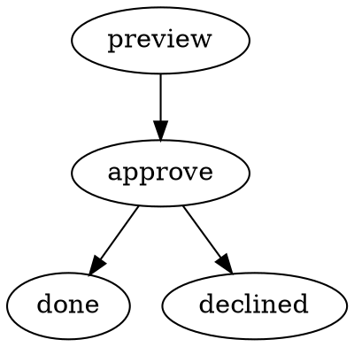

# Authoring workflows

A Runspore workflow has two required files: `workflow.dot` describes the steps and
arrows; `settings.json` describes what the steps do. The
[getting-started example](getting-started.md) is a complete runnable starting point.
This page explains how to extend it with real commands, data, and decisions.

These files use Runspore's current `runspore/0.2` dialect. The independent
[SWL standard](https://runspore.com/docs/swl) is a separate working draft; its
examples are not promised to run unchanged in this CLI.

## Put workflows in a project

```sh
spore init
mkdir -p .spore/workflows/review
```

Each workflow folder holds `workflow.dot`, `settings.json`, and any instruction,
schema, or asset files named by the settings. Commit these sources. `spore` can
also read a workflow folder anywhere else by path.

A bare name such as `spore run review` refers to the graph ID of a workflow under
`.spore/workflows/`, not necessarily its folder name. Use explicit paths when you
need to remove ambiguity.

## Add an approval

Save the following as `.spore/workflows/review/workflow.dot`:



Save the settings as `.spore/workflows/review/settings.json`:

```json
{
  "format": "runspore.workflow/0.2",
  "inputSchema": {
    "type": "object",
    "properties": { "message": { "type": "string" } },
    "required": ["message"],
    "additionalProperties": false
  },
  "actions": {
    "preview": {
      "kind": "command",
      "effect": "pure",
      "argv": ["cat"],
      "output": "json"
    }
  },
  "nodes": {
    "preview": {
      "action": "preview",
      "input": { "$get": ["input"] }
    },
    "approve": {
      "signal": "approval",
      "outputSchemas": {
        "rejected": {
          "type": "object",
          "properties": { "reason": { "type": "string" } },
          "required": ["reason"],
          "additionalProperties": false
        }
      }
    },
    "done": {
      "output": { "$get": ["nodes", "preview", "output"] }
    },
    "declined": {
      "error": { "code": "review.rejected", "message": "The review was rejected" }
    }
  }
}
```

Validate and start it:

```sh
spore validate review
spore run review --key review-1 --input '{"message":"Ready for review"}'
```

The preview completes, then the run waits for `approval`. `run` exits **3**, which
means it is waiting for a signal. This is expected. Copy the `run_…` value printed
by the command, replacing `run_your_id_here` below:

```sh
RUN_ID=run_your_id_here
spore step show "$RUN_ID"
spore signal "$RUN_ID" approval --outcome approved --id review-1-approval
spore continue "$RUN_ID"
```

The run completes. To exercise rejection, start a new run with a new key and send
`--outcome rejected --data '{"reason":"Needs changes"}'` to that run instead.
The rejection schema requires a reason; an invalid answer is refused without
moving the waiting step. [Running workflows](running-workflows.md) covers the
signal and resolution commands in more detail.

## Choose step kinds and arrows

| Node kind in `workflow.dot` | Settings entry | What happens |
| --- | --- | --- |
| `activity` (default) | `action`, optional `input` and `params` | Performs the named action |
| `await-signal` | `signal` | Waits for a named external answer |
| `complete` | Optional `output` | Ends successfully with the mapped result |
| `fail` | `error` | Ends with the declared error |

An arrow without `on` means `on="ok"`. An arrow's `label` changes its drawing,
not its routing. Declare one arrow per outcome: `on="approved"` and
`on="rejected"` are distinct decisions even if both point to the same node.
`failed` is reserved for a step failure, and `exhausted` for a loop limit.

The build checks that every node can be reached from the start and that an end can
be reached from every node. There is no fork/join execution or native `workflow`
node in the current runtime. A command can start child runs with `spore start`;
[Watch a run](watch-a-run.md) demonstrates that pattern and its explicit signals.

## Run your own command

An action named by an activity node can run a program directly. For example, the
following action runs tests and turns exit code 1 into the business outcome `red`:

```json
{
  "kind": "command",
  "effect": "read-only",
  "argv": ["npm", "test"],
  "outcomes": ["ok", "red"],
  "exitOutcomes": { "1": "red" },
  "timeoutMs": "60000",
  "retry": { "maxAttempts": 2 }
}
```

This is an **action fragment** to place under a name in `actions`, not a complete
settings file. A node that uses it needs arrows for `ok` and `red`. Classify the
effect according to what your own tests do: a test command that writes persistent
data needs a different effect declaration.

`argv` is an argument array, not a shell command string. Pipes, redirects, globbing,
and `$VARIABLE` expansion do not happen automatically. If a shell is required,
name it explicitly, such as `["/bin/sh", "-c", "your shell script"]`; keep untrusted
input out of shell text. Programs use the run's recorded base folder unless the
action declares another `cwd`. See [Projects and settings](project-settings.md#where-commands-run).

Runspore sends the node's evaluated input as JSON on stdin. Choose how it reads
stdout with the action's `output`:

| Mode | Meaning |
| --- | --- |
| `text` (default) | Records text output, including stdout/stderr information |
| `json` | Parses stdout as the step's JSON output |
| `result` | Reads a JSON answer such as `{"outcome":"ok","output":{"summary":"Done"}}` |
| `none` | Discards the result data; output is `null` |

In `json` or `result` mode, write logs to stderr so stdout contains only the result.
Runspore's JSON data uses integers rather than floating-point numbers; a result
must fit its supported data domain and any declared output schema.

An unmapped nonzero exit is a retryable command failure. A mapped `red` outcome is
a normal result that follows its arrow. Those two cases let you separate an
execution problem from an expected outcome of the work.

## Pass data between steps

A mapping is ordinary JSON with explicit operators where a value must be read or
computed. For example, a node input can combine run input and another node's result:

```json
{
  "message": { "$get": ["input", "message"] },
  "preview": { "$get": ["nodes", "preview", "output"] }
}
```

Useful roots are `input` (the run's input), `nodes` (the latest result of each
visited node), and `from` (the arrow and result that brought the run to this step).
A missing path fails the mapping; it is not replaced by an empty value. A back edge
creates a new visit, so use `from` when the incoming result matters more than the
latest result of a named node.

Use `params` for a node's action setup, such as instructions or tool arguments,
and `input` for the data being processed. A command's `argv` can contain mappings
that evaluate to strings. The [mapping contract](../../spec/kernel.md) and
[command contract](../../spec/host.md) define the available operators and roots.

## Declare effects and retries

Every action must say what repeating its work would do:

| Effect | Use when | After an interrupted try with no known result |
| --- | --- | --- |
| `pure` | The action only computes from its input | May retry within the retry limit |
| `read-only` | It reads outside state without changing it | May retry within the retry limit |
| `idempotent` | Repeating the operation cannot apply it twice | May retry within the retry limit |
| `unsafe` | Repetition could duplicate an external effect | Stops for a person's resolution |

The build defaults repeatable actions to three attempts unless
`retry.maxAttempts` is set. An `unsafe` action defaults to one. A retry is another
try of the same visit; it keeps `RUNSPORE_EFFECT_KEY`. If a service accepts an
idempotency key, pass that value to it. Merely declaring `idempotent` does not make
an external service deduplicate requests.

After attempts are exhausted, a `failed` arrow routes the failure. Without such an
arrow, a stuck activity pauses for a person to retry, complete, or fail it.
[Running workflows](running-workflows.md#recover-an-interrupted-or-stuck-step)
explains the resolution commands.

## Bound a loop

A back edge can return to an earlier step, for example from failed tests to an
implementation step. Give the decision node a limit on its repeated outcome:

```json
{
  "action": "test",
  "loopLimits": { "red": 3 }
}
```

This is a **node fragment**. Its DOT needs both the `red` arrow and an
`on="exhausted"` arrow to a different path, such as a signal asking for help. Three
consecutive `red` results take the normal `red` arrow; the next takes `exhausted`.
Another outcome resets the streak. Workflow-wide `maxVisitsPerNode` and
`maxActivations` are separate safety limits: reaching either fails the run.

The [Claude step guide](claude-step.md) shows a complete bounded implementation and
test loop. That integration is optional; the same control flow works with other
programs or [external actors](external-steps.md).

## Validate before starting

```sh
spore validate review
spore validate review --short
spore explain action.no-effect
spore validate review --fix
spore validate review --strict
```

`validate` reports problems without executing the workflow or opening the run
database. `--short` prints one line per diagnostic. `explain` provides the reason,
example, and fix offline. `--fix` edits only fixes marked safe; choosing an effect
remains the author's decision. `--strict` makes warnings fail validation too.
See the [validation guide](../validation.md) for a complete report.

Add the editor schema to the top level of a workflow's `settings.json` for field
completion:

```json
{
  "$schema": "https://raw.githubusercontent.com/Web-tree/runspore/main/spec/settings.schema.json"
}
```

That snippet shows only the added field. It does not replace the settings file.
Input and output schemas use a [defined JSON Schema subset](../../spec/schema.md),
not every JSON Schema keyword.

## Build and distribute a workflow

```sh
spore build .spore/workflows/review -o review.wasm
spore inspect review.wasm
spore run review.wasm --key review-artifact-1 --input '{"message":"Review this artifact"}'
```

The artifact seals the package and declared files. Files not declared by the
workflow are not included. Keep instruction and asset paths inside the workflow
folder; a build does not package arbitrary files from the rest of the repository.
An executable script referenced through the workflow must have its execute bit
set before the build when it is to be launched directly.

Each run stores its starting artifact. Changing the source or building a newer
artifact affects new runs; it does not hot-reload an existing one. Resume the
existing run by ID with `spore continue`. Use a new start key to run the new version.

`spore build --composed` is for a host that needs a workflow artifact and kernel in
one component. It is not needed for normal CLI use. `inspect` is a debugging aid;
its output is not a stable automation interface.
