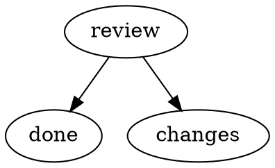

# External steps and async work

Use an external step when a person or another program should claim work and report
the result. Use an async command when Runspore should start the work, then let it
continue outside the worker. Both keep the run's progress in the same database.

This guide uses the current Runspore CLI and its `runspore/0.2` workflow dialect.
The supported CLI setup is one machine and one OS user. Actor labels select work;
they do not provide account permissions or a remote task service.

## Choose how a step runs

| You want to | Use |
| --- | --- |
| Run a program and wait for its exit | A `command` action; see [Authoring workflows](authoring-workflows.md) |
| Pause for an answer, without claiming work | An `await-signal` node; see [Running workflows](running-workflows.md) |
| Let a person or another program take responsibility for work | An `external` action and `spore step claim` |
| Start work that must outlive the worker process | A `command` action with an `async` object |
| Package a custom step runner with explicit host grants | A `component` action; see [the runner contract](../../spec/host.md#component-02) |

An external step is an activity with an outcome, an effect class and an attempt. An
await-signal node only waits for a named signal. Choose the former when you need a
claim, a token and a deadline; choose the latter for a simple approval or event.

## Try an external review

From your project, initialize Runspore if needed and create a workflow folder:

```sh
spore init
mkdir -p .spore/workflows/external-review
```

Save this as `.spore/workflows/external-review/workflow.dot`:



Save this as `.spore/workflows/external-review/settings.json`:

```json
{
  "format": "runspore.workflow/0.2",
  "actions": {
    "review": {
      "kind": "external",
      "actor": "reviewer",
      "effect": "unsafe",
      "outcomes": ["approved", "changes"],
      "async": { "timeoutMs": "3600000" }
    }
  },
  "nodes": {
    "review": {
      "action": "review",
      "input": { "$get": ["input"] }
    },
    "done": {
      "output": { "$get": ["nodes", "review", "output"] }
    },
    "changes": {
      "error": {
        "code": "review.changes",
        "message": "The reviewer requested changes"
      }
    }
  }
}
```

Validate and run it:

```sh
spore validate external-review
spore run external-review --key external-review-1 --input '{"summary":"Change the release checklist"}'
```

The run stops at `review` with exit **6**. That means an actor must claim the step;
it does not mean the workflow failed. Copy the run ID printed by `run` into the
variable below, replacing the example value:

```sh
RUN_ID='run_REPLACE_WITH_THE_PRINTED_ID'
spore step show "$RUN_ID"
spore step claim "$RUN_ID" --actor reviewer --holder '{"session":"terminal-1"}'
```

`show` describes the step without claiming or probing it. `claim` returns its input,
accepted outcomes, deadline and an opaque token. The holder handle is your own JSON
description of who is working; Runspore stores it for inspection. The actor label
must match `reviewer`. A claim without `--actor` only takes unlabelled work.

After doing the review, copy the printed token and report the answer:

```sh
TOKEN='REPLACE_WITH_THE_PRINTED_TOKEN'
spore step complete "$TOKEN" --outcome approved --output '{"reviewed":true}'
spore continue "$RUN_ID"
```

The run completes at `done`, with the supplied output. Reporting records the result;
a worker or `continue` applies it and advances the workflow. If a worker is already
serving this database, it can advance the run without that explicit `continue`.

The example has a one-hour deadline and no shorter renewable lease, so a person does
not have to keep renewing it. Its `unsafe` effect asks for intervention if the claim
expires with an unknown result. It does not silently assign the same review again.
Use a new start key, such as `external-review-2`, to try a fresh run.

## Claim work from a program

Use JSON output when integrating another program:

```sh
spore --json step claim --actor reviewer
```

Without a run ID, this claims the highest-priority eligible ready external step
matching the actor label in the selected database, then the oldest due step among
equal priorities. No work is a successful response with
`"claimed": false`; do not try to read a token in that case.

A successful claim includes `token`, `runId`, `nodeId`, `actionId`, `input`, `params`,
`outcomes`, `outputSchemas`, `deadlineMs`, `leaseUntilMs` and `resultChannel`. It also
includes paths for the step's files, instructions and work folder when available.
Follow those declared inputs and output schemas instead of assuming every external
step accepts the same answer. Keep the token private to the program doing that try.

For an action that sets a shorter `async.leaseMs`, renew before that lease expires:

```sh
spore step renew "$TOKEN"
```

Renewal never extends the original deadline. `leaseMs` and `timeoutMs` in an action's
settings are positive decimal strings, and a specified lease must be shorter than
the timeout. For example, an automated reviewer could use:

```json
{
  "async": {
    "timeoutMs": "3600000",
    "leaseMs": "120000"
  }
}
```

This is an action-settings fragment to merge into your action, not an entire
`settings.json` file.

Report an execution failure with `step fail`. Add `--retryable` only when another try
may help; the action's retry policy still limits it:

```sh
spore step fail "$TOKEN" --error 'The review tool was unavailable' --code review.unavailable --retryable
```

This is different from completing with the declared `changes` outcome. An outcome
routes the workflow normally; a failure invokes the workflow's failure and retry
rules. Without a usable failure route, an exhausted step needs intervention.

## Recover a held step

`spore status "$RUN_ID"` shows the holder and deadline, and can run the action's
probe. Use `spore status "$RUN_ID" --no-probe` for observation without that probe.

If the holder is no longer going to answer, `spore step abandon "$RUN_ID"` expires
the held attempt immediately. Its old token can no longer change the run. The
action's effect class determines what happens next: repeatable work may be retried;
work with an unknown unsafe result requires intervention. Inspect the real-world
result before choosing a resolution in [Running workflows](running-workflows.md).

Abandoning an attempt does not itself stop the external program. To end the whole
run, use `spore cancel "$RUN_ID" --reason 'Review no longer needed'`. An async
action can declare a stop program for cancellation, but that stop is best effort.

A `lease.lost` error means the token's attempt has ended or lost ownership. Do not
keep submitting that token. Inspect the run and let the current holder or the
resolution procedure decide the next action. A duplicate report can be recognized
as a duplicate; a conflicting or late report never replaces the accepted result.

## Start async work from a command

An async command's `argv` starts work elsewhere and exits with a small JSON holder
handle on stdout. That output identifies the work; it is not its result. The start
command receives `RUNSPORE_TOKEN` so the work can later renew, complete or fail the
step. Only the `store` result channel is currently available in this host.

Your integration must arrange the work's lifetime. A child left in the start
command's process group is stopped when that command ends; start work in its own
process group or through an appropriate local service, and redirect its stdout and
stderr away from the start command's captured streams so they can reach EOF. A repeatable start must use
`RUNSPORE_EFFECT_KEY` to find an already-started job if the attempt is repeated.

An async action can also declare:

| Program | Purpose |
| --- | --- |
| `probe` | Read the holder handle and report `alive`, `dead`, `unknown` or `stopped` |
| `watch` | Wait for the work and return its outcome and output |
| `stop` | Ask the work to stop when the run is cancelled |

`spore continue "$RUN_ID" --wait` follows held work until the run ends or needs an
answer. It may run the declared watch. A watch can report what its holder waits for
with a line such as `{"waits":"Review the proposed change"}`; that line returns
control to the driver without completing the held step, and the text shows as
`step.waits`. See
[Automation](automation.md) for exit-code handling and
[the async command contract](../../spec/host.md#async-commands-02) for the full
start/probe/watch/stop interfaces.

## Propose an answer before the work has stopped

An integration with a reliable probe can submit a candidate answer:

```sh
spore step propose "$TOKEN" --outcome approved --output '{"reviewed":true}'
```

This validates and stores the candidate but leaves the attempt held. The candidate
becomes the result only when the action's probe reports `stopped` or `dead`. If work
continues and invalidates it, run `spore step withdraw "$TOKEN"`. For a person simply
finishing the review in the tutorial, use `step complete`; a candidate without a
probe will not become a result just because it was proposed.

## Next

- [Automation](automation.md): JSON responses, CI exit codes and parent/child runs.
- [A Claude step with plain spore](claude-step.md): an existing command-based agent recipe.
- [CLI reference](cli-reference.md): every `step` command and its options.
- [CLI contract](../../spec/cli.md#steps-outside-the-worker-02): exact response shapes and refusal codes.
