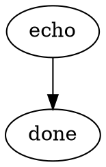

# Getting started

This guide installs `spore`, creates a workflow from an empty folder, runs it with
input, and shows how to find the saved result. It needs a macOS or Linux terminal
with a POSIX shell and the standard `cat` command. No agent, service account, or
Graphviz installation is needed for the example.

## Install spore

### Release installer

```sh
curl -fsSL https://raw.githubusercontent.com/Web-tree/runspore/main/install.sh | sh
```

The installer targets macOS and Linux on arm64 and x86_64; on Windows, run it in WSL.
It needs `curl`, `tar`, `ssh-keygen` with SSH signature verification, and `sha256sum`
or `shasum`. It checks the checksum file's signature and the archive's checksum before
installing the newest release to `~/.local/bin`. If an authenticated `gh` CLI is
available, it also verifies the build attestation.

Run the same command again to update: it replaces the installed `spore` with the
newest release and names the version it replaced.

To pin a release or choose an installation directory, pass the variables to the shell
that runs the script:

```sh
curl -fsSL https://raw.githubusercontent.com/Web-tree/runspore/main/install.sh \
  | SPORE_VERSION=VERSION SPORE_INSTALL_DIR="$HOME/.local/bin" sh
```

Replace `VERSION` with a release version. Releases 0.7.1 to 0.9.2 have no binary
archives and cannot be installed this way. Do not bypass a signature or checksum
failure. [Release verification](../../spec/release.md) documents the asset names and
pinned release key.

Make sure the installation directory is on `PATH`, then check the installation:

```sh
spore --version
spore capabilities
spore --help
```

`--version` identifies the installed software. `capabilities` reports its contract
versions, action kinds, and asynchronous result channels. This guide uses the
`runspore/0.2` workflow dialect; the software version is a separate number.

### From source

You need Git, Rust installed through `rustup`, and a native C compiler/linker for
the bundled SQLite dependency. On macOS the compiler comes with the Xcode Command
Line Tools; on Linux use your distribution's C development tools. The repository's
`rust-toolchain.toml` selects the Rust version and WebAssembly target needed by the
build.

```sh
git clone https://github.com/Web-tree/runspore.git
cd runspore
cargo install --path crates/runspore-cli --locked
```

Cargo puts the executable in `~/.cargo/bin` by default. Make sure that directory is
on `PATH`.

## Create a project

Create a new folder in your home directory, outside the Runspore source checkout:

```sh
cd "$HOME"
mkdir runspore-demo
cd runspore-demo
spore init
mkdir -p .spore/workflows/hello
```

`spore init` creates `.spore/` and `.spore/workflows/`. In a Git repository it uses
the repository root, including when called from a subfolder. Outside Git it uses
the current folder. It does not start a worker or create a database.

## Write the workflow

Save this as `.spore/workflows/hello/workflow.dot`:



The graph names the workflow `hello`. It starts at `echo`; that step's default
`ok` outcome takes it to `done`.

Save this as `.spore/workflows/hello/settings.json`:

```json
{
  "format": "runspore.workflow/0.2",
  "inputSchema": {
    "type": "object",
    "properties": {
      "message": { "type": "string" }
    },
    "required": ["message"],
    "additionalProperties": false
  },
  "actions": {
    "echo": {
      "kind": "command",
      "effect": "pure",
      "argv": ["cat"],
      "output": "json"
    }
  },
  "nodes": {
    "echo": {
      "action": "echo",
      "input": {
        "message": { "$get": ["input", "message"] }
      }
    },
    "done": {
      "output": { "$get": ["nodes", "echo", "output"] }
    }
  }
}
```

`cat` reads the step's JSON input from stdin and writes it to stdout. The
`"output": "json"` setting asks Runspore to parse that stdout as the step's output.
The `done` node returns it as the run's result. The action is `pure` because it only
copies its input and changes nothing outside the step.

## Validate and run

From `runspore-demo`:

```sh
spore validate hello
spore run hello --key hello-1 --input '{"message":"Hello from Runspore"}'
```

The name `hello` is resolved from the graph ID of a workflow under
`.spore/workflows/`. You can also pass `.spore/workflows/hello` or its
`workflow.dot` path.

Validation checks both source files and runs no actions. `run` builds the workflow
in memory, creates a run, and works until it completes or needs something from
outside. You should see `status completed` and a result containing
`{"message":"Hello from Runspore"}`. Progress goes to stderr; the final run status
goes to stdout.

The output includes a randomly generated `run_…` ID. `hello-1` is its **start key**:
repeating the same command with the same workflow and input returns that same run,
so the completed step is not repeated. Use a new key, such as `hello-2`, when you
want a new run. Reusing a key with different input or a changed workflow is refused.

## Find the saved result

```sh
spore list
```

Copy your run ID into the variable below, replacing `run_your_id_here`:

```sh
RUN_ID=run_your_id_here
spore status "$RUN_ID"
spore events "$RUN_ID"
```

`status` shows the result and where the run ended. `events` shows how it got there.
You can close the terminal and inspect it again later from the same project.

Runs normally live outside the project in `~/.spore/db/`; an explicit database or
an existing older project database can override that. `spore list --json` includes
the actual database path. [Projects and settings](project-settings.md) explains
the lookup and how worktrees share runs.

## Build a reusable artifact

You can run a folder directly, as above, or create an immutable workflow artifact:

```sh
spore build .spore/workflows/hello -o hello.wasm
spore run hello.wasm --key hello-artifact-1 --input '{"message":"From an artifact"}'
```

The artifact contains the workflow package and its declared files. It is input to
`spore`, not an executable program to launch by itself. A run keeps its original
artifact; editing the source folder later does not change that run.

## Next steps

- [Authoring workflows](authoring-workflows.md): add commands, branches, data
  mappings, and a signal that waits for your approval.
- [Running workflows](running-workflows.md): start a worker, continue a run, answer
  it, or recover after an interruption.
- [CLI reference](cli-reference.md): look up the command you need.
