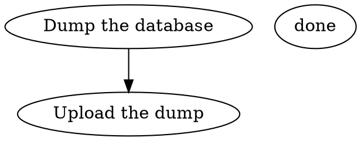
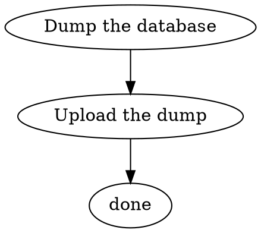

# Validating a workflow

`spore validate <workflow>` checks a workflow folder the way `start` would, without
running anything or touching the database, and reports **every problem at once**:
each with the lines you wrote, what is wrong in your own words and values, and a fix
built from them. This guide walks through one workflow, `nightly-backup`, from five
mistakes to a run.

The rules behind it are in [spec/dot.md §6](../spec/dot.md#6-diagnostics) and
[spec/cli.md, Validation](../spec/cli.md#validation-02); every code has a page in
[docs/codes](codes/README.md).

## The workflow as written

Two steps: dump a database, then upload the dump. `.spore/workflows/nightly-backup/`
holds the graph:



and the settings:

```json
{
  "format": "runspore.workflow/0.2",
  "actions": {
    "dump": {
      "kind": "command",
      "argv": ["pg_dump --format=custom --file=backup.dump shop"],
      "effect": "idempotent"
    },
    "upload": {
      "kind": "command",
      "argv": ["aws", "s3", "cp", "backup.dump", "s3://acme-backups/shop/latest.dump"]
    }
  },
  "nodes": {
    "dump": { "action": "dump" },
    "upload": { "action": "upload" },
    "outcomes": ["ok"]
  }
}
```

## One run, every problem

```text
$ spore validate nightly-backup
── No first step ────────────────── nightly-backup/workflow.dot:1  dot.no-start
The workflow does not say which step runs first.

  1 │ digraph "nightly-backup" {

To fix: add this line inside the braces:   start = "dump";

── Missing arrow ────────────────── nightly-backup/workflow.dot:5  dot.missing-arrow
Step "upload" can end with the outcome "ok", but no arrow leaves it for "ok".

  5 │   upload [label="Upload the dump"];
    │   ^^^^^^

To fix: draw the arrow, for example   upload -> done;
Why: action "upload" lists no outcomes, so it ends with "ok", and the run would have nowhere to go.

── "outcomes" is in the wrong place ── nightly-backup/settings.json:17  settings.misplaced-key
Every key under "nodes" must be a step in workflow.dot, and there is no step "outcomes".

 16 │     "upload": { "action": "upload" },
 17 │     "outcomes": ["ok"]
    │     ^^^^^^^^^^

To fix: outcomes belong on an action. Move this line into the action it describes, for example "actions" → "upload".

── Missing "effect" ────────────────── nightly-backup/settings.json:9  action.no-effect
Action "upload" does not say whether it is safe to run again after a crash.

  9 │     "upload": {
    │     ^^^^^^^^

To fix: add one of "pure" | "read-only" | "idempotent" | "unsafe" to action "upload". For example:

 11 │       "argv": ["aws", "s3", "cp", "backup.dump", "s3://acme-backups/shop/latest.dump"],
 12 │+      "effect": "idempotent"

Why: spore runs a step again after a crash only when its effect says that is safe.
More: spore explain action.no-effect

── Program name with spaces (warning) ── nightly-backup/settings.json:6  command.argv-spaces
"pg_dump --format=custom --file=backup.dump shop" is read as one program name. spore does not use a shell, so the words are not split.

  6 │       "argv": ["pg_dump --format=custom --file=backup.dump shop"],
    │                ^^^^^^^^^^^^^^^^^^^^^^^^^^^^^^^^^^^^^^^^^^^^^^^^^

To fix: give each word its own item.

  6 │       "argv": ["pg_dump", "--format=custom", "--file=backup.dump", "shop"],

More: spore explain command.argv-spaces

4 problems and 1 warning in nightly-backup. Nothing was run.
```

The exit code is 2: there are problems. Each block says one thing:

- the **heading** names the problem, then the file and line, then its code;
- the **message** says what is wrong, quoting your values;
- your **lines**, with the spot marked;
- **To fix**, with the fix spelled out from your own names. For some codes it shows
  the fix applied to your lines, with the added line marked `+`;
- **Why**, when the reason is not obvious, and **More**, when `spore explain <code>`
  has more to say.

The count comes last, because the end of the output is what you read first.

Read the blocks in order:

1. **No first step** ([`dot.no-start`](codes/dot.no-start.md)). `workflow.dot` needs a
   `start` line. spore suggests `dump`, the first step no arrow leads into.
2. **Missing arrow** ([`dot.missing-arrow`](codes/dot.missing-arrow.md)). The action
   `upload` lists no outcomes, so it ends with `ok`, and nothing says where the run goes
   then. spore suggests the arrow to `done`, the workflow's end. Notice what spore does
   *not* say: that `done` cannot be reached. That follows from the missing arrow, and
   one mistake gives one message.
3. **"outcomes" is in the wrong place**
   ([`settings.misplaced-key`](codes/settings.misplaced-key.md)). Every key under
   `"nodes"` is a step of `workflow.dot`, and there is no step `outcomes`: the list
   belongs on an action. Here it says `["ok"]`, which is what an action without
   `outcomes` ends with anyway, so the line can simply go.
4. **Missing "effect"** ([`action.no-effect`](codes/action.no-effect.md)). Every
   action says whether it is safe to run again after a crash. spore cannot guess this
   for you: it lists the four effects and shows one applied to your lines. Copying a
   file to the same place again changes nothing more, so `upload` is `idempotent`.
5. **Program name with spaces** ([`command.argv-spaces`](codes/command.argv-spaces.md)),
   a warning. spore runs `argv` without a shell, so `"pg_dump --format=custom …"` would
   be looked for as one program, and the step would fail when it starts. The fix gives
   each word its own item.

Warnings do not change the exit code: a program name with spaces is allowed, just
unlikely. `spore validate --strict` makes warnings fail too, for CI. A program that is
not on this machine's `PATH` is a warning as well
([`command.program-not-found`](codes/command.program-not-found.md)), since the run may
happen on another machine.

## Fixing

Each fix is marked **safe** (it cannot change what the workflow means), **needs
review**, or **needs a choice**. `spore validate --fix` applies the safe ones, writes
the files, shows each change, and checks again:

```text
$ spore validate --fix nightly-backup
Fixed command.argv-spaces in nightly-backup/settings.json:
  6 │-      "argv": ["pg_dump --format=custom --file=backup.dump shop"],
  6 │+      "argv": ["pg_dump", "--format=custom", "--file=backup.dump", "shop"],

…
4 problems in nightly-backup. Nothing was run.
```

The other four are yours to make: which step runs first, where `upload` leads, and
above all which effect `upload` has are decisions about your workflow, so `--fix`
never makes them. After them the folder reads:



```json
{
  "format": "runspore.workflow/0.2",
  "actions": {
    "dump": {
      "kind": "command",
      "argv": ["pg_dump", "--format=custom", "--file=backup.dump", "shop"],
      "effect": "idempotent"
    },
    "upload": {
      "kind": "command",
      "argv": ["aws", "s3", "cp", "backup.dump", "s3://acme-backups/shop/latest.dump"],
      "effect": "idempotent"
    }
  },
  "nodes": {
    "dump": { "action": "dump" },
    "upload": { "action": "upload" }
  }
}
```

```text
$ spore validate nightly-backup
nightly-backup is valid
$ spore run nightly-backup
```

## For scripts and editors

`--short` prints one line per problem, the way compilers do:

```text
$ spore validate --short nightly-backup
nightly-backup/workflow.dot:1:1: dot.no-start: The workflow does not say which step runs first.
nightly-backup/workflow.dot:5:3: dot.missing-arrow: Step "upload" can end with the outcome "ok", but no arrow leaves it for "ok".
nightly-backup/settings.json:17:5: settings.misplaced-key: Every key under "nodes" must be a step in workflow.dot, and there is no step "outcomes".
nightly-backup/settings.json:9:5: action.no-effect: Action "upload" does not say whether it is safe to run again after a crash.
nightly-backup/settings.json:6:16: command.argv-spaces: "pg_dump --format=custom --file=backup.dump shop" is read as one program name. spore does not use a shell, so the words are not split.
```

`spore --json validate` prints `{valid, problems, warnings, diagnostics}`. Each
diagnostic carries its code, message and fix as text, its place as a `range` and a JSON
Pointer, the values it quotes with the pointers they came from, and its fixes as edits
with their applicability, so a script can fix its own mistakes without reading text
and an editor can show them as it shows a compiler's. The fields are in
[spec/cli.md](../spec/cli.md#validation-02).

`settings.json` may start with
`"$schema": "https://raw.githubusercontent.com/Web-tree/runspore/main/spec/settings.schema.json"`.
Editors that read JSON Schema then complete the keys and mark wrong values as you type.
The schema is generated from the same types the build reads, so the two cannot disagree.

`spore explain <code>` prints a code's page offline, and `spore explain` lists every
code.
